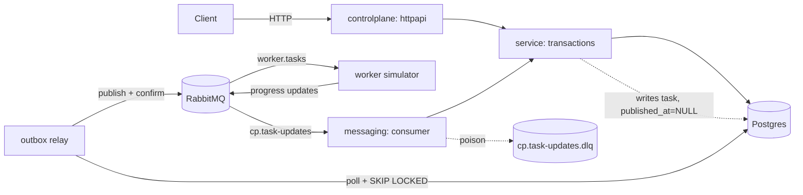

# Day 4 — Messaging and ControlPlane end to end

**Goal:** own the architecture. By the end you can draw it from memory, explain every arrow, and defend
the outbox, inbox, rank guard, publisher confirms, DLQ, and lock order with a crash point and a
tradeoff.

**You should be able to answer:** why not publish in the request, what `published_at` means, why
`FOR UPDATE SKIP LOCKED` must share a transaction, why publisher confirms are not enough without
`mandatory`, how the inbox and rank guard differ, and what happens at every crash point.

---

## Timebox (120 min)

| Time | Block |
|---|---|
| 0:00–0:10 | Cold recall: draw the architecture with no notes |
| 0:10–0:50 | Mechanisms below |
| 0:50–1:25 | Active practice: sequences + 12 decisions |
| 1:25–1:45 | Grill |
| 1:45–1:55 | Explain-back: "walk me through one task" |
| 1:55–2:00 | Log weak spots |

---

## 1. The problem shape

A tenant signup must create a durable record immediately, but provisioning takes minutes and can fail.
The API cannot hold the HTTP request open for minutes, and it cannot do the work itself if it wants to
scale workers independently.

So:

- **Synchronous:** validate, write the tenant and a task row, commit, return 201/202.
- **Asynchronous:** a worker consumes the task, does the long work, reports progress.
- **Correctness:** the control plane is the source of truth; the worker is untrusted and may crash,
  retry, duplicate, or reorder.

The demo is not "look, a queue." The demo is "look, the system stays correct when the queue misbehaves."

### Architecture



Layering:

| Package | Responsibility |
|---|---|
| `domain` | Pure state machines, slug rule, error codes, timestamp format. No I/O. |
| `store` | Postgres queries, schema, `WithTx`, `DB` interface. |
| `service` | Use cases and transaction boundaries. The only writer of tenant/task state. |
| `httpapi` | chi routes, validation, error envelope, pagination. |
| `messaging` | AMQP connection manager, topology, publisher, consumer. |
| `outbox` | Relay loop bridging `store` → `messaging`. |
| `worker` | Stateless simulator. No DB. |

**One deployable unit, two processes:** the control plane process runs HTTP + relay + consumer; the
worker process runs separately. The worker has no DB connection; it trusts the task message, and the
consumer is the final authority on task existence and tenant mapping.

---

## 2. Outbound: transactional outbox

### The request transaction

`POST /v1/tenants` does three things in **one** transaction:

1. `INSERT tenants (... status='provisioning', version=1)`.
2. `INSERT tasks (... type='deploy', status='accepted', published_at=NULL)`.
3. Commit.

The task row **is** the outbox row. `published_at IS NULL` means "not yet handed to the broker."

After commit, the service calls `notify()` to wake the relay. The relay also polls every 500 ms as a
safety net. The notification is an optimization, not the correctness mechanism.

### Why not publish inside the request?

Two bad orderings:

- **Publish, then commit:** broker gets the event, DB commit fails → worker acts on a tenant that does
  not exist.
- **Commit, then publish:** DB commit succeeds, process crashes before publish → event is lost forever.

There is no atomic commit across Postgres and RabbitMQ without a distributed transaction (2PC), and
RabbitMQ is not XA-capable. The outbox makes "publish only after commit" structural: the event is a
row in the same transaction as the state change, and the relay publishes committed rows.

### The relay

```sql
SELECT id, tenant_id, type, status, created_at, updated_at, tenant_slug, tenant_name
FROM tasks
WHERE published_at IS NULL
ORDER BY id
LIMIT 100
FOR UPDATE SKIP LOCKED;
```

For each claimed row:

1. Publish to `cp.tasks` with routing key `task.<type>`.
2. Wait for a **publisher confirm**.
3. `UPDATE tasks SET published_at = now() WHERE id = $1`.
4. Commit.

Why one transaction around claim + publish + mark:

- Postgres row locks are **transaction-scoped**. Outside a transaction, the `SELECT` lock is released
  when the statement finishes, and a second relay can claim the same rows.
- `SKIP LOCKED` lets concurrent relay replicas skip rows another transaction holds, so they claim
  disjoint batches.
- If the process crashes between confirm and commit, the row is still unpublished and will be
  republished on restart. That is **at-least-once**, never at-most-once, and never before commit.

### Publisher confirms, `mandatory`, and returns

- `PublishWithContext` returning nil only means the bytes reached the socket. It does not mean the
  broker persisted or routed the message.
- `Confirm(false)` puts the channel in confirm mode. The publisher waits for `basic.ack`; a `basic.nack`
  is an error.
- `mandatory=true` turns "no queue matched this routing key" from a silent drop into a `basic.return`.
  A confirm alone does **not** prove routing; RabbitMQ can confirm an unroutable message.
- `basic.return` precedes `basic.ack` on the wire. The publisher must drain a return that arrived just
  before the confirm so it is not mistaken for the next publish.

### Ordering and multiple relays

- Rows are claimed in `id` order within a batch, but multiple relays and retries mean global ordering is
  not guaranteed. The consumer must be order-tolerant.
- A single relay with one channel publishes sequentially; throughput is bounded by confirm latency.
  Batching confirms or multiple channels can improve throughput, at the cost of more in-flight state.
- The relay's `wake` channel is buffered with capacity 1 and uses a non-blocking send: a pending wake
  already covers subsequent commits; the poll is the fallback.

### Broker down for an hour

The API keeps accepting tenants: the outbox rows are durable in Postgres. The relay logs errors and
retries. When the broker returns, the backlog drains. The cost is latency: tenants sit in
`provisioning` until the relay publishes and a worker processes them. The outbox grows; monitor its
oldest unpublished age, not just its count.

### Does the outbox grow forever?

In this demo, yes; rows are retained as task history. In production, archive/partition published rows
after a retention window, or move task history to a separate table. Do not delete unpublished rows.
Monitor `min(created_at) WHERE published_at IS NULL` as the real lag signal.

---

## 3. Inbound: idempotent consumer + inbox

### The update message

```json
{
  "schema_version": 1,
  "message_id": "...",
  "task_id": "...",
  "tenant_id": "...",
  "status": "done",
  "occurred_at": "2026-01-01T00:00:00.000Z",
  "error": {"reason": "..."}
}
```

`message_id` is **deterministic**: `UUIDv5(task_id + "/" + status)`, implemented as
`uuid.NewSHA1(uuid.NameSpaceURL, []byte(taskID.String()+"/"+status))`.

- Same task + same status → same ID, even across retries, worker restarts, and broker redelivery.
- `done` and `failed` have different IDs.
- The worker's `occurred_at` may differ between duplicates; the ID is what deduplicates.

### The consumer transaction

`ApplyTaskUpdate` runs one DB transaction:

1. `INSERT INTO processed_messages (message_id, task_id) VALUES (...) ON CONFLICT DO NOTHING`.
   - `RowsAffected() == 0` → duplicate. Commit, ack, no state work.
2. Load the task. Unknown task → permanent `task_not_found` (poison, DLQ).
3. Lock the tenant, then the task (`SELECT ... FOR UPDATE`). The message's `tenant_id` is **not
   trusted** for state changes; the task row is the source of truth.
4. If the task is terminal or `rank(new) <= rank(current)` → stale. Commit, ack, no regression.
5. Otherwise update the task. If the new status is terminal, apply the tenant outcome in the same
   transaction, guarded on the expected in-flight status, and increment the tenant version.
6. Commit, then ack.

Why the inbox insert and state change share one transaction: if the inbox row committed separately, a
crash could mark the message processed while the state change was lost. Why insert first: it serializes
concurrent duplicates on the `message_id` primary key; the second delivery blocks until the first
commits, then sees zero rows.

### Rank guard

| Status | Rank |
|---|---:|
| `accepted` | 0 |
| `in_progress` | 1 |
| `done` | 2 (terminal) |
| `failed` | 2 (terminal) |

Apply iff `rank(new) > rank(current)`.

- Duplicate `done` → `2 > 2` false → stale, ack.
- Late `in_progress` after `done` → `1 > 2` false → stale, ack.
- `accepted → done` → `2 > 0` true; allowed if `in_progress` was lost or delayed.
- First terminal outcome wins; the other is stale.

Why not a from→to table: one comparison covers every self-loop, duplicate, and reordered case. A table
would need explicit self-loops and stale transitions for every status.

Why both inbox and rank guard: they solve different problems. The inbox deduplicates the **same
logical message** (same `message_id`). The rank guard handles **different messages** that arrive out of
order (e.g. a new `in_progress` message after `done`). You need both.

### Terminal tenant mapping

| Task type | Expected in-flight tenant status | On done | On failed |
|---|---|---|---|
| `deploy` | `provisioning` | `active` | `failed` |
| `update` | `updating` | `active` | `failed` |
| `destroy` | `destroying` | `destroyed` | `failed` |

The tenant update is guarded: `WHERE id = $1 AND status = $expected`. If the tenant has moved on (a
newer lifecycle action), zero rows match and the stale outcome is dropped. The tenant version increments
on every terminal outcome, so clients holding an old optimistic token get `tenant_version_conflict`.

### Lock order

Tenant first, then task — everywhere. The API path touches tenant before task; the consumer does the
same. Reversing the order in one path creates an ABBA deadlock. Two different messages for the same task
converge on the same row locks; the inbox and rank guard make the result deterministic.

### Poison vs transient

| Failure | Classification | Action |
|---|---|---|
| Malformed JSON | Permanent | `Nack(requeue=false)` → DLQ |
| Invalid schema version / unknown status | Permanent | DLQ |
| Unknown task/tenant | Permanent | DLQ |
| Recovered handler panic | Permanent for that message | DLQ |
| DB connection reset / timeout / pool exhaustion | Transient | Bounded in-process retry, then requeue |
| Repeated redelivery | Broker | `x-delivery-limit=5` → DLQ |

The consumer recovers panics per delivery so one bad message does not kill the process. Transient
retries are bounded (3 attempts with backoff); the broker's delivery limit caps the outer loop.

---

## 4. RabbitMQ topology and resilience

### Topology

| Name | Type | Purpose |
|---|---|---|
| `cp.tasks` | direct exchange | Outbound task routing |
| `worker.tasks` | quorum queue | Work; bound to `task.deploy`, `task.update`, `task.destroy` |
| `cp.task-updates` | direct exchange | Inbound progress routing |
| `cp.task-updates` | quorum queue | Progress; bound to `task.update.<status>`; `x-delivery-limit=5`; DLX → DLQ |
| `cp.task-updates.dlq` | durable queue | Poison messages and exhausted retries |

Why direct exchanges: routing keys are a closed vocabulary (`task.<type>`, `task.update.<status>`).
Direct is exact-match and simple. A topic exchange would be useful for wildcard subscriptions, which
this design does not need. Every routing key a producer can emit must have an explicit binding, or
`mandatory` turns the silent drop into a returned message.

Why quorum queues: replicated, durable, and designed for at-least-once work with poison-message
handling. They require `durable=true`; queue type and delivery limit are table arguments, not
positional.

### Ack, nack, prefetch

- Manual ack, not `autoAck=true`. Auto-ack loses the message if the consumer crashes after receiving it.
- Ack only after the handler's DB transaction commits. If the ack is lost, the broker redelivers and
  the inbox makes it a no-op.
- `Nack(requeue=false)` dead-letters poison; `Nack(requeue=true)` returns transient failures to the
  queue. Requeueing a decode error is an infinite hot loop.
- `Qos(10)` for the consumer bounds unacked deliveries. The worker uses `Qos(1)` because tasks are
  long-running and sequential.

### Reconnect

AMQP connections are expensive; channels die with their connection. `ConnManager` owns one connection:
it watches `NotifyClose`, redials with capped exponential backoff + jitter (250 ms → 10 s for the
consumer, 500 ms → 30 s for the manager), re-declares the idempotent topology, and hands out fresh
channels. A closed `NotifyClose` channel returns nil forever; the watcher reacts to channel closure
itself, not to a nil error value.

Why jitter: without it, every replica reconnects at the same instant and creates a thundering herd.

---

## 5. Failure matrix — rehearse this

| Crash/failure point | Outcome |
|---|---|
| Between tenant/task INSERT and commit | Rollback: no tenant, no task, no event. Client sees 5xx; retry may hit `tenant_already_exists` if the commit actually succeeded, which is correct. |
| Between commit and relay publish | Relay republishes on next poll/restart. At-least-once. |
| Between publish confirm and marking `published_at` | Row remains unpublished; republished on restart. Duplicate delivery possible; worker must tolerate. |
| Worker crashes mid-task | Task message unacked → broker requeues → another worker picks it up. |
| Worker crashes after terminal update confirmed but before ack | Broker redelivers the task; worker replays updates with the same deterministic IDs; consumer treats them as duplicates/stale. |
| Consumer crashes mid-`ApplyTaskUpdate` | Transaction rolls back; message unacked; redelivered; inbox insert ensures no double-apply. |
| Consumer applies terminal update but ack is lost | Redelivery hits the inbox duplicate path; tenant version does not bump twice. |
| Duplicate terminal update | Same `message_id` → inbox `ON CONFLICT DO NOTHING` → no-op. |
| Stale `in_progress` after `done` | Different message ID, but rank guard rejects → no-op. |
| Malformed/unknown task | `Nack(requeue=false)` → DLQ; consumer continues. |
| Broker down | API still accepts; outbox accumulates; relay retries; consumer reconnects. |
| Worker down | Tasks queue; tenants remain in-flight until a worker returns. |
| Stuck task forever | No reaper in this build — a known gap. Production needs a TTL/heartbeat/reconciler. |

**Exactly-once is not possible** across a DB and a broker without distributed transactions. The design
is at-least-once + idempotent apply + order tolerance = **effectively-once** business effect.

---

## 6. Decisions to defend (60 seconds each)

| # | Decision | Alternative rejected | Why |
|---|---|---|---|
| 1 | Go + Postgres + RabbitMQ | Python/Kafka | Go's concurrency fits the conditional-update/goroutine model; Postgres constraints do the hard invariant work; RabbitMQ's per-message ack + DLX is simpler than Kafka offsets for poison handling. |
| 2 | Transactional outbox | Publish in request / 2PC | 2PC needs XA; publishing in-request risks publish-before-commit or commit-without-publish. Outbox makes "after commit, never on rollback" structural. |
| 3 | Deterministic `message_id` + inbox | Broker dedup | Brokers don't guarantee dedup under at-least-once; a DB inbox is explicit, transactional, auditable. |
| 4 | Rank guard | From→to table | One comparison covers duplicate, stale, and reorder. |
| 5 | Conditional UPDATE | Read-then-write / app mutex | One statement is race-free; an app mutex does not cross replicas; advisory locks add surface. |
| 6 | Slug tombstoning | Hard delete + separate taken-slugs table | Rows are never deleted; `UNIQUE(slug)` automatically covers destroyed tenants. |
| 7 | UUIDv7 + keyset pagination | Serial IDs + OFFSET | Time-ordered IDs are a valid cursor; keyset avoids page drift. |
| 8 | Desired-state PATCH | Flip status only, apply name later | The caller sees the name recorded now; status tracks reconciliation (k8s spec/status style). |
| 9 | At-least-once, not exactly-once | Exactly-once | Exactly-once is impossible here; idempotency is the honest, testable guarantee. |
| 10 | Direct exchanges + quorum queues | Topic exchange / classic queues | Closed routing vocabulary; quorum gives durability/replication and a delivery limit. |
| 11 | Tenant → task lock order | Per-path ordering | Consistent order prevents ABBA deadlocks. |
| 12 | One open task per tenant | External lock service | Status guards + partial unique index enforce it in the DB. |

---

## 7. Scale, alternatives, and honest gaps

### At 10x

- Batch relay confirms and/or use multiple relay channels; monitor oldest unpublished age.
- Partition/shard by tenant for worker throughput; preserve per-tenant ordering if required.
- Add a stuck-task reaper/heartbeat; the current build has none.
- Archive published outbox rows; index only what you query.
- Add metrics/tracing (outbox lag, publish latency, consumer lag, DLQ depth, retry rate, task age).
- Add auth/RBAC, per-tenant rate limits, and worker sharding for noisy neighbors.
- Replace idempotent `ON CONFLICT` growth with a retention policy for `processed_messages`.
- Consider Kafka if you need replay/partitioned logs; keep RabbitMQ if per-message ack/DLX is the
  priority. Do not switch for fashion.

### Alternatives

- **SQS/SNS:** managed, DLQ, visibility timeout, at-least-once. Mapping the outbox to SQS is natural;
  the inbox/idempotency logic is unchanged. FIFO queues can help ordering but add throughput limits.
- **Kafka:** durable log, replay, partitions. Consumer offsets and poison-message handling are a
  different operational model; a single poison message can block a partition unless you build a
  retry/DLQ topic.
- **DB polling only:** simplest, but you still need a worker; the outbox relay is already a DB poller.
- **2PC:** not available with RabbitMQ; avoid.

### Known limitations to name before they do

- No auth/TLS/RBAC; local `guest/guest`.
- Schema applied with `CREATE ... IF NOT EXISTS`, no migration tool.
- `worker.tasks` has no DLQ/delivery limit; a malformed task is logged/discarded and a worker panic can
  redeliver repeatedly.
- Worker publishes `in_progress` after the delay, not before long work.
- No stuck-task reaper/heartbeat/reconciliation.
- Metrics/tracing absent; JSON logs + RabbitMQ UI only.
- No dedicated HTTP/worker unit tests; covered by live API + lifecycle test.
- `make check` incomplete (lint placeholder, Windows fmt-check).

---

## 8. Active practice (35 min)

### Drill 1 — draw it (10 min)

Draw the architecture and the two sequences from memory:

**Create:** client → API → tenant/task transaction → commit → notify → relay claim → confirm → mark
published → worker → `in_progress`/`done` → consumer inbox → rank guard → tenant outcome → ack.

**Update:** client PATCH → conditional update + update task → commit → relay → worker → update
messages → consumer → tenant back to active.

Then mark every crash point and say the recovery.

### Drill 2 — 12 decisions (12 min)

Use a timer. For each row in the decisions table, say:

1. The decision.
2. The alternative.
3. The failure mode the alternative creates.
4. The cost of your choice.

If you cannot do one in 60 seconds, mark it red and revisit after the grill.

### Drill 3 — fault-injection predictions (8 min)

Before running anything, predict:

| Injection | Task state before | Expected tenant version | Expected task status | Where the message ends |
|---|---|---|---|---|
| duplicate `done` | done | unchanged | done | inbox duplicate no-op |
| stale `in_progress` | done | unchanged | done | rank guard stale no-op |
| poison JSON | any | unchanged | unchanged | DLQ |
| `FAIL_RATE=1` deploy | accepted | bumps once | failed | tenant failed |

Then run them in Day 5 and compare. The gap between prediction and observation is your study list.

### Drill 4 — whiteboard "what if" (5 min)

Answer in 30 seconds each:

- Broker down for an hour.
- Relay crashes after confirm, before commit.
- Worker crashes after terminal confirm, before ack.
- Consumer crashes after DB commit, before ack.
- Two different messages for the same task arrive concurrently.
- A task is stuck in `in_progress` forever.

---

## 9. Grill

<details>
<summary><strong>Q1. Why is provisioning asynchronous?</strong></summary>

It takes minutes and can fail/retry; holding an HTTP request open is fragile and wastes a connection.
The API commits the durable intent (tenant + task) and returns; a worker does the long work and reports
progress.

</details>

<details>
<summary><strong>Q2. Why a transactional outbox instead of publishing in the request?</strong></summary>

Publishing before commit can make the worker act on a tenant that does not exist. Committing before
publish can lose the event if the process crashes. A DB transaction cannot atomically include RabbitMQ,
and RabbitMQ is not XA. The outbox row commits with the state change; the relay publishes only
committed rows.

</details>

<details>
<summary><strong>Q3. What exactly is the outbox here?</strong></summary>

The `tasks` table itself. A task row with `published_at IS NULL` is the unpublished event. There is no
separate outbox table; the task is both the durable work record and the event to publish.

</details>

<details>
<summary><strong>Q4. Why is `published_at` separate from `tasks.status`?</strong></summary>

They answer different questions. `status` is the business state (`accepted`/`in_progress`/`done`/
`failed`); `published_at` is the delivery state (has the relay handed this task to the broker?). Mixing
them would make one field serve two lifecycles and break retries/auditing.

</details>

<details>
<summary><strong>Q5. Why `FOR UPDATE SKIP LOCKED`?</strong></summary>

`FOR UPDATE` claims rows; `SKIP LOCKED` lets concurrent relay replicas skip rows already locked by
another transaction. They claim disjoint batches and do not double-publish. Without `SKIP LOCKED`,
replicas block or contend on the same rows.

</details>

<details>
<summary><strong>Q6. Why must claim + publish + mark share one transaction?</strong></summary>

Postgres row locks are transaction-scoped. Outside a transaction, the claim lock is released when the
SELECT finishes, so another relay can claim the same rows. Keeping the transaction open through publish
and `published_at` makes the claim exclusive and only marks published after the broker confirms.

</details>

<details>
<summary><strong>Q7. Why publisher confirms?</strong></summary>

A plain publish returning nil only means the bytes reached the socket. A confirm means the broker took
responsibility (persisted/routed, depending on queue). The relay must not mark `published_at` until the
broker confirms, or a crash after marking can lose the event.

</details>

<details>
<summary><strong>Q8. Why `mandatory=true` and returns?</strong></summary>

A confirm does not prove routing: RabbitMQ can confirm an unroutable message. `mandatory` makes an
unroutable message return via `basic.return`. The publisher waits for a return or a confirm; a return
is an error, not a silent drop.

</details>

<details>
<summary><strong>Q9. At-least-once vs exactly-once?</strong></summary>

At-least-once means a message may be delivered more than once but not lost. Exactly-once across a DB
and a broker requires distributed transactions or a shared log; RabbitMQ + Postgres cannot do it here.
The design uses at-least-once plus idempotent apply and order tolerance for an effectively-once business
effect.

</details>

<details>
<summary><strong>Q10. Why are duplicate deliveries acceptable?</strong></summary>

Because the consumer is idempotent: the inbox primary key rejects the same `message_id`, and the rank
guard rejects stale/different messages. Duplicates cost work, not correctness. The alternative
(exactly-once) is not achievable with these components.

</details>

<details>
<summary><strong>Q11. What if the relay crashes between confirm and commit?</strong></summary>

The row is still `published_at IS NULL`; on restart the relay republishes. That is a duplicate
delivery, which the worker/consumer tolerate. It is never a lost event and never a publish before
commit.

</details>

<details>
<summary><strong>Q12. What if the broker is down for an hour?</strong></summary>

The API still accepts writes; outbox rows accumulate in Postgres. The relay retries and drains when
the broker returns. Tenants stay in `provisioning`/`updating`/`destroying` until published and
processed. Monitor oldest unpublished age, not just queue count.

</details>

<details>
<summary><strong>Q13. Does the outbox grow forever?</strong></summary>

In this demo, published task rows are retained as history, so yes. Production would archive/partition
published rows after retention while keeping unpublished rows. Never delete unpublished rows; monitor
their age.

</details>

<details>
<summary><strong>Q14. Multiple relays — how do they avoid double-claiming?</strong></summary>

`FOR UPDATE SKIP LOCKED` inside the relay transaction. Each relay locks a batch; other relays skip
those rows and claim different ones. The lock is held through publish + mark + commit.

</details>

<details>
<summary><strong>Q15. Does the outbox guarantee ordering?</strong></summary>

No global ordering. A single relay processes a batch in `id` order, but multiple relays, retries, and
worker concurrency can reorder delivery. The consumer's rank guard is the order-tolerance mechanism.
If strict per-tenant ordering is required, add a per-tenant sequence and a single consumer/partition
key.

</details>

<details>
<summary><strong>Q16. Why deterministic `message_id`?</strong></summary>

A worker retry or broker redelivery of the same logical update must produce the same inbox key. A random
UUID per attempt would defeat deduplication. `UUIDv5(task_id + "/" + status)` is stable and scopes the
key to one task/status.

</details>

<details>
<summary><strong>Q17. Why both the inbox and the rank guard?</strong></summary>

The inbox deduplicates the same logical message (same `message_id`). The rank guard handles different
messages that arrive out of order (e.g. a new `in_progress` after `done`). They solve different
problems; removing either leaves a gap.

</details>

<details>
<summary><strong>Q18. Why insert the inbox row first, not after the state change?</strong></summary>

It serializes concurrent duplicates on the `message_id` primary key. The second delivery blocks until
the first transaction ends, then sees zero rows. If you inserted after the state change, two deliveries
could both do state work before discovering the duplicate.

</details>

<details>
<summary><strong>Q19. What does `ON CONFLICT DO NOTHING` return, and what do you do?</strong></summary>

`RowsAffected() == 0` means the message was already processed. Commit, ack, and return a duplicate
result. `RowsAffected() == 1` means this transaction owns the message and may apply the state change.

</details>

<details>
<summary><strong>Q20. Explain the rank guard.</strong></summary>

`accepted=0`, `in_progress=1`, `done/failed=2`. Apply iff `rank(new) > rank(current)`. Duplicate
terminal is `2 > 2` false → stale. Late `in_progress` after `done` is `1 > 2` false → stale.
`accepted → done` is `2 > 0` true → allowed if `in_progress` was lost. One comparison covers
idempotency and order tolerance.

</details>

<details>
<summary><strong>Q21. Why not a from→to transition table?</strong></summary>

It would need an explicit self-loop for every duplicate and a stale transition for every reordered
pair. The rank comparison encodes the forward-only invariant directly and handles `accepted → done`
without special cases. It is less code and fewer states to get wrong.

</details>

<details>
<summary><strong>Q22. Why lock tenant before task?</strong></summary>

Consistent lock order prevents ABBA deadlocks. The API path touches tenant before task; the consumer
does the same. Reversing in one path lets two transactions each hold one lock and wait for the other.

</details>

<details>
<summary><strong>Q23. Why update the tenant only on terminal task updates?</strong></summary>

`in_progress` does not change the tenant's lifecycle state; it only confirms work is underway. Terminal
`done`/`failed` drives `provisioning → active/failed`, `updating → active/failed`, or
`destroying → destroyed/failed`. Updating the tenant on every progress message would add writes and
version churn for no state change.

</details>

<details>
<summary><strong>Q24. Why bump the tenant version on a terminal outcome?</strong></summary>

The version is the optimistic-concurrency token. A terminal outcome changes the tenant's state, so a
client holding the old version must get `tenant_version_conflict` on its next write. It also gives
clients a way to detect that the async operation completed.

</details>

<details>
<summary><strong>Q25. Why is the message's `tenant_id` not trusted?</strong></summary>

The task row is the source of truth. A malformed or malicious message could claim a different tenant;
the consumer loads the tenant from `task.tenant_id` and ignores the message's claim. This limits blast
radius and keeps tenant scoping consistent with the DB.

</details>

<details>
<summary><strong>Q26. Poison vs transient — how do you classify?</strong></summary>

Permanent/poison: malformed JSON, invalid schema, unknown status, unknown task/tenant, recovered panic.
These will never succeed on retry → `Nack(requeue=false)` → DLQ. Transient: connection reset, timeout,
pool exhaustion → bounded in-process retry, then requeue. Requeueing poison is an infinite hot loop.

</details>

<details>
<summary><strong>Q27. Why `x-delivery-limit=5`?</strong></summary>

It caps broker-side redelivery of a message that keeps failing transiently. After 5 attempts, RabbitMQ
dead-letters it. Without a cap, a persistent failure loops forever and consumes capacity.

</details>

<details>
<summary><strong>Q28. Why quorum queues?</strong></summary>

They are replicated and durable, designed for at-least-once work, and support a delivery limit. A
classic non-durable queue can lose messages on broker restart. Quorum queues require `durable=true`;
the queue type and delivery limit are table arguments, not positional.

</details>

<details>
<summary><strong>Q29. Why reconnect with backoff + jitter?</strong></summary>

AMQP connections are expensive and channels die with them. A supervisor reconnects, re-declares the
idempotent topology, and hands out fresh channels. Backoff avoids hammering a down broker; jitter
prevents all replicas reconnecting in lockstep (thundering herd).

</details>

<details>
<summary><strong>Q30. Why does the consumer process sequentially?</strong></summary>

It wants bounded unacked deliveries and simple ordering/failure classification. The DB transaction is
the correctness boundary, not a goroutine per message. Parallel consumers would need per-tenant
ordering, more careful inbox/lock behavior, and a way to bound concurrency. Start sequential; scale
with partitions/consumers when measured.

</details>

<details>
<summary><strong>Q31. Why does the worker have no DB connection?</strong></summary>

The worker is untrusted and stateless. It consumes a task message, does the work, and publishes
progress. The consumer is the final authority on task existence, tenant mapping, and state transitions.
This keeps the worker simple and limits its blast radius if compromised.

</details>

<details>
<summary><strong>Q32. Why prefetch 1 on the worker?</strong></summary>

Tasks are long-running and sequential. Prefetch 1 means at most one unacked task in flight, so a crash
causes exactly one redelivery. It sacrifices throughput for predictable recovery and simple ordering.

</details>

<details>
<summary><strong>Q33. Why ack the task only after the terminal update is confirmed?</strong></summary>

If the worker acks the task before the terminal update is durably accepted, a crash can lose the
outcome. Ack-after-confirm means the broker has the terminal update before the task is removed. If the
ack is lost, the task is redelivered and the deterministic IDs make the replay a no-op.

</details>

<details>
<summary><strong>Q34. What if a task is stuck in `in_progress` forever?</strong></summary>

This build has no reaper/heartbeat, so it stays stuck and the tenant stays in-flight. Production needs a
TTL/lease, a reaper that re-publishes or fails stale tasks, and reconciliation with the provider. Name
this as a known gap rather than pretending the demo is production-complete.

</details>

<details>
<summary><strong>Q35. What would you change at 10x?</strong></summary>

Batch relay confirms and monitor oldest unpublished age; partition/shard workers by tenant; add a
stuck-task reaper; archive published rows; retention for `processed_messages`; metrics/tracing; auth and
per-tenant rate limits; worker sharding for noisy neighbors. Keep the invariants; change the scale
knobs.

</details>

---

## 10. ControlPlane tie-in

| Mechanism | File | What to say |
|---|---|---|
| Outbox claim | [`internal/store/outbox.go`](../../Avid/ControlPlane/internal/store/outbox.go) | `FOR UPDATE SKIP LOCKED` inside the relay transaction; join tenant data so payload construction cannot fail after the claim. |
| Relay | [`internal/outbox/relay.go`](../../Avid/ControlPlane/internal/outbox/relay.go) | Claim → publish with confirm → mark → commit; poll + non-blocking wake. |
| Publisher | [`internal/messaging/publisher.go`](../../Avid/ControlPlane/internal/messaging/publisher.go) | Confirm mode, `mandatory`, returns, persistent delivery. |
| Topology | [`internal/messaging/topology.go`](../../Avid/ControlPlane/internal/messaging/topology.go) | Direct exchanges, quorum queues, DLX, delivery limit. |
| Consumer | [`internal/messaging/consumer.go`](../../Avid/ControlPlane/internal/messaging/consumer.go) | Ack after commit, poison vs transient, bounded retry, panic recovery. |
| Apply update | [`internal/service/task.go`](../../Avid/ControlPlane/internal/service/task.go) | Inbox first, lock tenant→task, rank guard, terminal mapping. |
| Inbox | [`internal/store/inbox.go`](../../Avid/ControlPlane/internal/store/inbox.go) | `ON CONFLICT DO NOTHING`; guarded tenant update. |
| State machines | [`internal/domain/statemachine.go`](../../Avid/ControlPlane/internal/domain/statemachine.go) | Rank guard, terminal mapping, tenant guards. |
| Connection manager | [`internal/messaging/connection.go`](../../Avid/ControlPlane/internal/messaging/connection.go) | Reconnect, re-declare topology, NotifyClose nuance. |
| Worker | [`internal/worker/worker.go`](../../Avid/ControlPlane/internal/worker/worker.go) | Prefetch 1, ack-after-confirm, duplicate/reorder/fail knobs. |

**Say this in the interview:** "The API transaction writes the task with `published_at = NULL` and
commits. A relay claims it with `FOR UPDATE SKIP LOCKED`, publishes with confirms and `mandatory`, and
marks it published in the same transaction. On the way back, the worker's deterministic `message_id`
hits an inbox table, the rank guard rejects stale/duplicate progress, and the task + tenant update
commit together before the ack. Every crash point either republishes, redelivers, or dead-letters —
never silently loses the event."

---

## 11. End-of-day checkpoint

- [ ] Draw the architecture and both sequences from memory.
- [ ] Explain the outbox and the two bad publish orderings.
- [ ] Explain `SKIP LOCKED`, transaction-scoped locks, and the crash window.
- [ ] Explain confirms + `mandatory` + returns.
- [ ] Explain `message_id`, inbox, rank guard, and why both inbox and rank exist.
- [ ] Explain terminal tenant mapping, guarded update, version bump.
- [ ] Explain poison vs transient, DLQ, delivery limit, quorum.
- [ ] Name five known limitations without being prompted.

**If you only remember five things:** commit then outbox then publish; claim/publish/mark one
transaction; deterministic ID + inbox; rank guard; ack after commit.

**Next:** [`day-5-demo-rehearsal.md`](day-5-demo-rehearsal.md).
